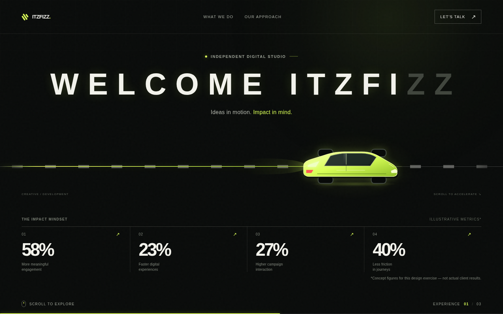
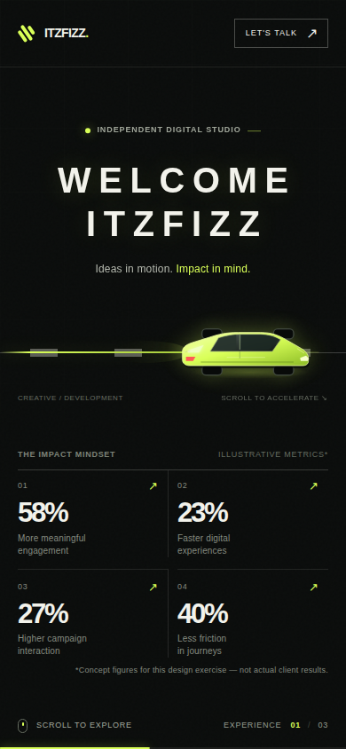

# ITZFIZZ — Scroll Experience

A scroll-driven hero and landing-page concept built for the **Itzfizz Digital Web Development internship assignment**.
A pinned GSAP / ScrollTrigger timeline drives a vector sports car across a road while the letter-spaced
**WELCOME ITZFIZZ** headline lights up letter by letter as the car's nose passes it.

- **Live demo:** https://sanjj17.github.io/itzfizz-scroll-experience/
- **Repository:** https://github.com/sanjj17/itzfizz-scroll-experience

<<<<<<< HEAD
| Desktop | Mobile |
| --- | --- |
|  |  |

> **Concept note:** the four percentages in the hero are illustrative design content, not actual Itzfizz or client results.

## Assignment checklist

| Requirement | How it is met |
| --- | --- |
| Hero fills the first screen | Pinned `100svh` stage with nav, headline, road scene and metrics above the fold |
| Letter-spaced headline | `WELCOME ITZFIZZ` set with wide tracking (`--track`), one line on desktop, two lines on mobile |
| Impact metrics | Four percentage cards with short descriptions and a count-up on load |
| Smooth load animation | Staggered nav, eyebrow, per-letter headline reveal, car slide-in, metrics one by one |
| Scroll-driven main visual | Car position is scrubbed by scroll progress (`scrub: 0.7` gives the easing); reverses when scrolling up |
| Performance | Transforms and opacity only while scrolling; letters toggle a CSS class on threshold; no layout reads per frame |
| Tech stack | HTML, CSS, JavaScript, GSAP + ScrollTrigger, Next.js / React, Tailwind CSS |
| Hosting | GitHub Pages via the included GitHub Actions workflow |
=======
## Live demo
 URL here:

`https://sanjj17.github.io/itzfizz-scroll-experience/`
>>>>>>> 80e0de61be3e65cc7487cd219a2d9e7868224959

## Tech stack

- Next.js App Router with static export
- React
- Tailwind CSS (layout utilities) plus hand-written CSS for the visual design
- GSAP + ScrollTrigger

## How the animation works

1. **Intro (time based).** One GSAP timeline reveals the nav, headline letters (staggered `yPercent` / `rotateX`),
   subtitle, car and metrics. Metric numbers count up from 0.
2. **Scroll journey (progress based).** A second timeline is attached to ScrollTrigger with `pin`, `scrub`,
   `invalidateOnRefresh` and `anticipatePin`. It moves the car, stretches the trail, fills the progress bar and
   drifts the background halo.
3. **Letters follow the car.** On every ScrollTrigger refresh each letter's centre is converted into a progress
   threshold. While scrolling, a letter only toggles an `is-lit` class when the car's nose crosses it, so there are
   no per-frame style writes and the effect reverses cleanly when scrolling back up.
4. **Cheap glow.** Scroll velocity only changes the opacity of a glow layer (compositor friendly) instead of
   re-computing a CSS filter every frame.

Other details: the intro elements are hidden by CSS until GSAP reveals them (no flash of un-animated content, with a
5s safety net), `prefers-reduced-motion` skips the pinned journey and shows the finished state, and
`ScrollTrigger.config({ ignoreMobileResize: true })` stops mobile address-bar jumps.

## Run locally

Use Node.js 20.9 or newer (Node.js 22 is recommended).

```bash
npm install
npm run dev
```

Open `http://localhost:3000`.

To build the deployable static site:

```bash
npm run build
```

The generated site is written to `out/`. Preview it with `npx serve out`.

## Deploy to GitHub Pages

1. Push this folder to the `main` branch of a repository named `itzfizz-scroll-experience`.
2. In **Settings → Pages**, set the source to **GitHub Actions**.
3. `.github/workflows/deploy.yml` builds the static export and publishes `out/` on every push to `main`.

If you use a different repository name, the workflow reads it automatically and sets the correct base path.

## Testing checklist

- Scroll slowly and quickly through the hero: car position and letter reveal follow scroll progress.
- Scroll back up: the letters dim and the car reverses.
- Check about 1440px desktop, 768px tablet and 390px mobile widths.
- Enable the browser's reduced-motion preference and reload.
- Confirm there are no console errors and every nav link reaches a real section.

## Project structure

```text
app/
  globals.css          # Tailwind layers + visual design and responsive rules
  layout.js            # Metadata, viewport and the tiny `js` class script
  page.js              # Page composition
components/
  HeroExperience.jsx   # GSAP intro + ScrollTrigger journey
  CarIllustration.jsx  # Original inline SVG car
  Services.jsx         # Agency service cards + modal
  Footer.jsx           # Contact section
docs/                  # README preview images
.github/workflows/
  deploy.yml           # GitHub Pages static deployment
```
